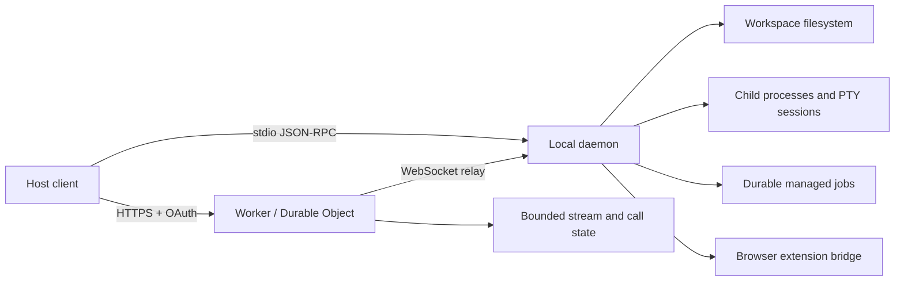
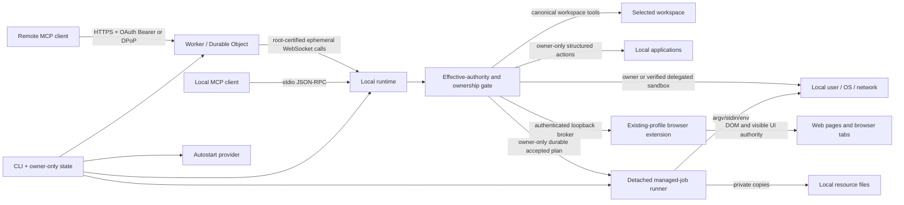
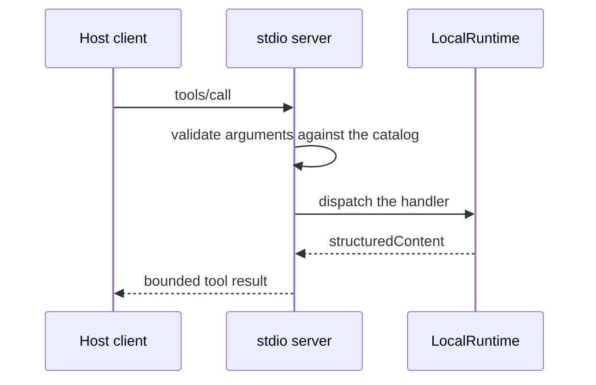

# Architecture

For a compact component map, read [System overview](OVERVIEW.md).
Security assumptions, attacker models, non-goals, and residual risks are defined in [Threat model](THREAT_MODEL.md).

## Design goal

The system separates four questions that are often conflated:

1. **Who may request an operation?** Remote OAuth account/client identity and role, or the local process identity that launched stdio.
2. **Which tools exist?** The shared tool catalog, policy profile, and account-role intersection.
3. **Is this remote effect inside the current authority?** The daemon ceiling, account role, trusted client, account version, refresh family, operation invariants, and object owner must all agree.
4. **What can an authorized tool actually do?** The local runtime, workspace/path rules, operating-system user authority, and platform security controls.

No transport is treated as a sandbox. Both transports invoke the same local runtime.

## Components

Three separately deployable pieces share one authority model. The Worker holds no workspace
state, the daemon trusts no network peer, and a host client never gains authority by caching a
contract. [Component reference](architecture/components.md) owns the per-module responsibilities
and split boundaries; this section keeps only the shape.

## Trust boundaries

Remote OAuth binds each code, access token, and refresh token to a named Machine Bridge account, account version, and role, so accounts are independent application-level authorization principals.
The Worker intersects that role with the connected daemon policy, and the local runtime enforces the relayed authorization again.
This distinction is not operating-system tenancy: every account still reaches one daemon, workspace, browser profile, and OS user authority.
Local stdio access relies on the local process and configuration boundary.
A connector host can independently present a smaller tool subset to a session; this post-relay filtering is outside the protocol state visible to Machine Bridge.
Canonical resolution limits direct filesystem tools.
Processes retain local-user authority and can escape workspace constraints through their own code or system calls.

## Remote request lifecycle

1. The MCP client discovers protected-resource and authorization-server metadata.
2. It dynamically registers bounded redirect metadata.
Per-source throttling counts only registrations that have not yet completed authorization, while a separate global cap bounds all retained clients.
3. The Worker validates authorization parameters before displaying a password form.
4. The user verifies client name and redirect URI and enters a Machine Bridge account name and password.
5. The Worker creates a five-minute code bound to client, redirect, resource, normalized scope, and PKCE challenge.
6. A valid verifier exchanges the one-time code for an expiring access token and refresh token; only their hashes are stored.
A refresh request is bound to the original public client, account, scope, resource, account version/role, deployment token version, and optional DPoP key.
Rotation derives one replacement pair from the consumed token and the private deployment token version, then permits at most two identity-equivalent responses with that exact pair during a 30-second concurrency window; over-budget retries are throttled, and replay after the window revokes the family.
7. A native MCP client sends `server/discover` or another request with MCP `2026-07-28` metadata on every call.
It receives no protocol session; request and cancellation ownership are scoped to that individual request or response stream, so separate clients may reuse the same typed JSON-RPC ID even with one OAuth token.
Discovery returns static bounded guidance, while `session_bootstrap` explicitly refreshes authority-permitted local/project instructions and context.
Remote HTTP and stdio reject removed initialization/session markers with bounded upgrade guidance before tool dispatch.
8. A new daemon first authenticates as a bounded `probing` socket.
The Worker sends a random `relay_probe` over the daemon control plane; the local runtime returns the matching control result, and only that result produces `ready_ack`, promotion to the active daemon, and safe replacement of an incumbent connection.
This readiness exchange is below MCP and has no protocol-session identity.
9. `tools/list` is a stable package-and-account-role discovery catalog; a brief relay interruption does not mutate it.
Current MCP `2026-07-28` discovery declares `listChanged: true` so long-lived hosts can subscribe to a level-trigger tool-list freshness edge and re-fetch the catalog after a package/Worker generation change.
Default full stdio retains `listChanged: false`; progressive mode advertises its actual list-change support.
`server_info.authorization.effective_tools` is the live daemon/account intersection and is the authority diagnostic.
10. A `tools/call` receives a random relay call ID only after role-visible name and raw arguments pass the shared schema gate.
A JSON response remains in the initiating Durable Object event.
If the Worker selects SSE, the outer Worker assigns a random private stream capability, makes one authenticated direct Durable Object request, and forwards the non-resumable response stream.
If the public stream closes, a second credential-free internal request presents only that capability; it is handled before OAuth/DPoP and can cancel only the matching active call.
No descriptor, terminal-result registry, recovery GET, event ID, protocol session, or `Last-Event-ID` state exists.
11. The local runtime validates policy and arguments, executes the tool, and produces a bounded JSON-serializable result.
It retains the daemon-to-Worker terminal envelope after WebSocket queueing and replays it until the Worker returns `tool_result_ack`; queue acceptance is not durable delivery.
This is relay execution continuity, not MCP replay.
Closing an HTTP response cancels its pending call through the private stream control.
12. The Durable Object accepts a result only from the registered WebSocket generation.
A transient call settles its in-memory pending record and current HTTP response.
If the daemon socket drops, the call may detach below the MCP transport for the bounded same-daemon reconnect interval; the same daemon-process identifier may reclaim it only after a fresh readiness probe, while a new daemon process cannot.
A stale socket result or close event cannot settle or detach a rebound call.
Public HTTP recovery remains impossible: once the response stream is gone, the call is cancelled rather than exposed through replay.
13. Daemon delivery is at-least-once until `tool_result_ack`.
The generation guard and authoritative `resume_calls` set make duplicate relay delivery converge without reviving removed calls.
Result handling records three exact dispositions: `committed`, `owner_missing_acknowledged` for a late result whose request owner already settled, and `stale_connection_rejected` for a superseded socket.
Late owner-missing results are acknowledged only so the daemon can release its recovery queue; stale-socket results are not acknowledged.
On readiness handover, the runtime cancels active calls and queued results absent from `resume_calls` before accepting `ready_ack`.
14. A tool deadline cancels only that operation and never infers daemon death from tool duration.
The independent daemon-liveness alarm owns socket invalidation.
If same-instance readiness does not return before the grace deadline, the Worker rejects the detached request and the local runtime cancels ordinary calls, terminates their process trees, and discards queued results.
A newly started daemon has a different instance identifier and cannot inherit prior calls.
On an intentional runtime stop, planned drain runs before relay close: the Worker classifies and settles old-daemon ownership while the old process is still connected, so a later different-instance startup no longer has to communicate that planned boundary through an indistinguishable WebSocket 1006/EOF.
This is structured recovery, not cross-process call migration.
15. `start_job` is different: after durable acceptance, the detached runner is no longer bound to an MCP response stream or daemon socket.
Later cancellation uses `cancel_job` or the local CLI.
Cancellation-aware main steps re-read the owner-only cancellation marker after asynchronous resource admission/launch preparation and immediately before synchronous `spawn`; that marker read is the managed-job launch decision point.
A marker already visible there prevents child creation, while cancellation appearing after the decision is post-dispatch and terminates the owned process tree.
Because that marker is cross-process filesystem state, the cancellation API is a request/terminal-state protocol rather than a claim that its return instant is an atomic wall-clock barrier against a concurrently racing OS spawn syscall.

HTTP JSON-RPC IDs are scoped to each request or response stream and are not used as a token-wide duplicate key, so independent clients may reuse the same typed ID.
Stdio has one process-local in-flight ID index because all requests share one explicit transport channel.

## Stdio request lifecycle

1. The local client launches `machine-mcp stdio` with a workspace and profile.
2. MCP `2026-07-28` requests carry version and client capabilities in every request `_meta` and require no initialization handshake.
`session_bootstrap` is an explicit context-refresh tool rather than initialization behavior.
3. Tool discovery is generated from the same catalog and policy used by remote mode.
4. Each call receives an internal random call ID used only for cancellation and process tracking.
5. Input is parsed as incrementally bounded newline-delimited JSON-RPC, so an oversized line is discarded before unbounded buffering and the next line can still be processed.
Results are emitted as JSON-RPC on stdout; logs remain on stderr.
6. Duplicate in-flight request IDs are rejected, and `tools/call` requires a non-null request ID so write or execution calls cannot run as unacknowledged JSON-RPC notifications.
7. Closing stdin cancels pending calls, terminates ordinary active processes/process sessions, and removes the transport runtime directory.
Previously accepted managed jobs continue in their persistent per-workspace job directories.

## Filesystem resolution and privacy

The workspace is canonicalized and compared with targets through consistent platform-native/async `realpath` representations.
Existing targets must remain inside the workspace unless the active policy is unrestricted.
New targets walk to the nearest existing ancestor, validate its canonical path, and reconstruct the destination below that canonical ancestor.

Path behavior is profile-dependent.
The default `full` profile permits unrestricted direct filesystem paths and returns absolute paths.
The `agent`, `edit`, and `review` profiles enforce canonical workspace containment and return workspace-relative paths.
Error strings redact canonical and common platform-alias forms of workspace, runtime, and home paths whenever absolute path display is disabled.
Access scope and path display are independent: unrestricted access with path display disabled returns relative workspace paths and opaque external-path identifiers.

Symbolic-link destinations and non-regular write targets are rejected.
Write paths always canonicalize their nearest existing ancestor, including under `full`, so transaction classification and execution agree on the real destination while unrestricted-path authority remains intact.
Patch move destinations are included in that classification.
Existing bounded reads add final-component `O_NOFOLLOW` where supported.
Recursive walkers do not follow symbolic-link directories.
Because portable Node.js lacks descriptor-relative `openat` traversal for every operation, parent-directory replacement by hostile same-user code remains an external-isolation concern.

## Mutation model

Filesystem mutations coordinate by already-resolved canonical path rather than one global runtime queue.
Operations touching the same canonical path serialize; independent paths may proceed concurrently.
A multi-path patch transaction reserves every resolved source and destination before awaiting any prior reservation, so overlapping transactions cannot deadlock through partial reservation while unrelated paths remain independent.

### Whole-file write

A same-directory temporary file is created with restrictive permissions.
Existing mode is preserved when replacing a regular file.
Expected hashes are rechecked immediately before commit.
Create-only uses a hard-link commit that fails atomically if the destination appeared concurrently.

### Exact edit

The current UTF-8 content is hashed.
The old fragment must exist and, unless `replace_all` is set, occur exactly once.
The resulting file is bounded and committed only if the original hash is unchanged.

### Patch transaction

The patch parser accepts a strict Begin/End envelope with add, update, move, and delete operations.
It rejects malformed hunks, absent or ambiguous context, duplicate textual paths, and different paths that resolve to the same filesystem location.

Before commit, all sources and targets are resolved and validated, updated content is computed, and temporary files are staged.
Source hashes and destination absence are rechecked.
Existing sources are renamed to backups, staged files are committed, and any failure rolls back committed operations in reverse order.
Backups are deleted only after full success.

This is a process-level transaction, not a filesystem-wide atomic transaction across multiple directories. Each individual staged file is published with a no-overwrite hard-link operation, but the set of files is not atomically visible as one unit.

If an ordinary operation fails, the transaction compensates in reverse order and restores source backups without overwriting a path that another actor has replaced. If compensation cannot prove and restore the original file identities, it returns non-retryable `patch_recovery_incomplete`; callers must inspect the affected paths before retrying. A staging-only cleanup failure is reported separately, while cleanup failure after a successful commit is a warning and does not imply rollback.

A process crash or power loss between moving a source to its backup and publishing the replacement can leave a source temporarily absent and `.mbm-backup-*` / `.mbm-patch-*` artifacts behind. There is no durable patch journal or automatic startup rollback for that crash window; `tests/atomic-fs-test.mjs` reproduces it by terminating a child process immediately after the source-to-backup rename. Recovery is therefore operator-led: inspect source, target, backup and staging artifacts, compare content and file identity where possible, and restore only when ownership is unambiguous. Single-file `write_file` and `edit_file` continue to use same-directory atomic rename and do not share this multi-file visibility limitation.

## Process model

Child-process ownership, resource admission, PTY sessions, and bounded output buffering are
specified in [Process model](architecture/process-model.md). Two invariants matter elsewhere
in this document: every spawned process belongs to a verified owner chain, and every launch
passes resource admission before it may start.

## Worker deployment convergence

Worker deployment is an explicit evidence state machine owned by `worker-deployment.mjs`.
Native `cf build` stages one immutable source snapshot in a bounded private project, and `cf deploy --prebuilt --secrets-file` owns the authoritative remote write.
`cloudflare.config.ts` preserves the selected Worker name, the existing `BridgeRoom` SQLite Durable Object export and self-binding, both rate-limit namespace identities, and the explicit secret/plain-text/JSON binding preservation metadata; `wrangler.config.ts` supplies the builder's minification settings.
Generated output is validated before upload.
Public `/healthz` is a subsequent read used to verify Worker identity and package version; it is not a transaction commit signal for the upload and does not attest the active device-authentication secret.
The v6 deployment fingerprint is an HMAC over individually length-framed protocol marker, Worker name, file count, normalized relative paths, and the same bytes passed to the build.
Required Worker/shared/native-config/private-toolchain inputs are traversed with `lstat`, and file bytes use bounded descriptor-first no-follow reads with multiple-hard-link rejection; absent, inaccessible, symlinked, special, or identity-changing inputs fail before upload.
After a successful cf result, local state atomically records the detected `workers.dev` URL, MCP URL, content/secret fingerprint, deployed package version, and timestamp before health verification begins.
If verification is ambiguous, the next start compares the same fingerprint and performs a read-only verification rather than repeating the remote write.
Owner-authorized candidate activation adds the missing end-to-end evidence: device preflight, signed challenge authentication, and readiness probing.
An explicit authentication rejection after current-version health permits one same-name redeployment with the unchanged selected identity; ordinary timeout, proxy, TLS, network, and temporary health failures do not.

`worker-health.mjs` owns bounded health I/O: exact HTTPS `workers.dev` origin and Worker-name validation, environment-proxy selection, request timeout, redirect rejection, response-size limit, JSON/identity/version validation, and coarse error classification.
`network-proxy.mjs` is shared by remote HTTP health probes and relay construction.
Worker health continues to honor the standard `HTTP_PROXY`, `HTTPS_PROXY`, and `NO_PROXY` model.
Relay WebSocket additionally accepts the relay-only `MBM_RELAY_PROXY` override: a non-empty value selects that HTTP(S) proxy before standard environment resolution, while an empty value restores the standard model.
Signed HTTP fallback inherits the same relay override by default, but `MBM_RELAY_FALLBACK_PROXY` can select a different explicit HTTP(S) proxy or, when present and empty, restore standard environment resolution for only that fallback.
Proxy URLs and credentials are never exposed.
Local browser-broker health uses `loopback-health.mjs`, which accepts only canonical `http://127.0.0.1:<port>/healthz`, disables agent reuse, bounds the response, and deliberately bypasses environment proxies.
Definitive stale evidence is retried for propagation and then permits a same-name redeploy; timeout, TLS, network, proxy, and temporary server failure remain ambiguous and fail without upload.

Worker-name mutation is a separate identity transition.
Existing state rejects a different name unless the caller also supplies the explicit force option.
An authorized transition clears the current URL/fingerprint and appends the prior validated name to bounded uninstall inventory.
This prevents a health-retry workaround from silently becoming a new remote resource while preserving cleanup of intentional replacements.

## Daemon reconnect and replacement

The local `RelayConnection` treats proxy selection, transport construction, WebSocket open, authentication, end-to-end readiness, and outage recovery as separate states.
The shared proxy module maps WebSocket targets to HTTP(S) CONNECT routing, rejects non-HTTP(S) proxy schemes, and creates proxy agents without exposing their URLs or credentials.
Normal relay selection uses standard environment-proxy resolution and honors `NO_PROXY`; a non-empty `MBM_RELAY_PROXY` instead fixes WSS to that explicit proxy and deliberately bypasses `NO_PROXY`.
Signed HTTP fallback inherits that route unless `MBM_RELAY_FALLBACK_PROXY` is present: a non-empty value fixes fallback to its own explicit proxy, while an empty value re-enables standard environment-proxy resolution for only the fallback.
Proxy connection failure does not authorize an undeclared direct retry.
These controls affect only Machine Bridge's application-layer proxy hop: physical-interface binding, upstream proxy protocol, upstream DNS, and any OS VPN/TUN interception remain below this boundary.
Splitting WSS and fallback therefore reduces application-layer common-mode failure but does not prove independent operating-system failure domains.
Invalid proxy configuration is a fatal configuration error rather than a retryable outage.

A connection-attempt deadline terminates sockets stuck in `CONNECTING`.
After open, the daemon sends `hello`; `hello_ack` establishes an authenticated relay generation and starts liveness monitoring, but does not resolve startup or advertise readiness.
The Worker then sends a random `relay_probe`.
Its result must traverse the local runtime dispatcher and `sendForSession` on that generation before `ready_ack` marks the connection usable.
The daemon rejects ordinary tool calls before that state and rejects a premature readiness acknowledgement without locally recorded probe delivery.
Independent handshake and readiness deadlines terminate candidates that authenticate but cannot return results.
Once authenticated, `RelayLiveness` sends a protocol-level WebSocket Ping every five seconds.
The full ten-second Pong deadline begins only after the sender write callback proves the control frame left the local queue.
Ping/application-send completions are fenced to the exact current WebSocket generation, so a callback from a superseded socket cannot mutate the replacement connection; a Ping callback that never completes has its own thirty-second local dispatch bound and becomes `relay_transport_send_timeout` even when the receive direction remains active.
Reaching that first-stage deadline no longer immediately kills a ready WSS: `relay-transport-confirmation.mjs` opens one bounded fifteen-second application-confirmation window and emits the existing JSON heartbeat only after the connection is fully ready.
A later protocol Pong or the explicit JSON application `pong` is bidirectional transport proof and clears suspicion; unrelated application messages update receive-side liveness only and cannot prove that daemon-to-Worker writes are succeeding.
`ResilientRelayConnection` keeps HTTPS fallback stopped while WSS is verified healthy.
During first-stage transport suspicion it concurrently prewarms signed HTTPS in standby without Worker-side takeover; confirmed WSS recovery stops that prewarm, while a real disconnect upgrades it to exact-generation takeover and preempts any stale standby request.
A ready HTTPS fallback idles at five-second polls, successful standby probes retry at thirty seconds, and handshake or queued outbound work retains the 750 ms minimum request-start interval.
A scheduling-responsive true black hole therefore remains bounded to one five-second probe interval plus ten-second Pong response and fifteen-second independent confirmation, while a single ten-to-fifteen-second persistent-flow stall no longer becomes an avoidable reconnect storm.
A detected local event-loop stall cancels remote suspicion and follows the separate recovery-grace branch rather than being counted as network failure.
Transport Ping remains active during authenticated probing, but application heartbeat/confirmation is gated on verified readiness because the Worker probing state accepts only the readiness-probe result.
Same-instance reconnect also performs explicit call-ownership reconciliation: the Worker sends its still-waiting IDs; the daemon snapshots the union of active calls and unacknowledged results, completes replacement-channel readiness, then returns `resume_calls_ack.missing_ids` only for IDs absent from that ownership union.
Those IDs alone may receive one same-ID transport redelivery inside the original remaining deadline; if that cannot be done safely they settle retryably with `side_effects_started=false`.
Active calls and retained terminal results continue on existing ownership, and no possibly executed tool call is automatically replayed.
A separate JSON application heartbeat remains at twenty-five seconds and retains a seventy-five-second application-silence timeout, so protocol-level Pong cannot mask a Worker application path that has stopped responding.
On the Worker, authenticated application-heartbeat activity refresh is synchronous and its JSON `pong` is queued before Durable Object alarm inspection or mutation; heartbeat and terminal-result paths then own one explicit coalesced alarm schedule.
Persistent deadline work therefore cannot sit in front of application-liveness acknowledgement or be scheduled twice through a hidden touch helper.
The Worker's ninety-second daemon-liveness deadline remains an independent wider fallback across Durable Object hibernation.
Worker error codes `daemon_transport_error` and `daemon_liveness_timeout` are connection-recovery signals, not protocol incompatibility: they terminate only the current socket, run normal disconnect cleanup, and enter bounded reconnect.
Local protocol-watchdog expiry is classified separately as `relay_transport_timeout`; local application-silence expiry retains `relay_heartbeat_timeout`.
The same Worker classification is applied to the close frame if the preceding error frame is lost.
Failure to send `hello`, or failure to deliver a readiness-probe result because its socket/session ended, follows the same transport-recovery path rather than being promoted to authentication or protocol failure.
Unknown Worker errors, authentication rejection, malformed readiness sequencing, and identity/version mismatch remain fatal.
Outage reminders run on their own exponential-backoff timer rather than depending on another transport callback.
Each new authenticated hello also carries a schema-versioned, bounded relay diagnostic summary, including `previous_ready_inbound_silence_ms` so the silent half-open interval before close is not collapsed into the shorter close-to-ready outage duration.
The local connection additionally keeps `recent_outages`, a newest-first in-memory ring capped at eight completed reconnect episodes.
The ring contains only bounded outage numbers, first/final disconnect and ready timestamps, durations, close/error classes, prior-ready duration/silence, the first disconnect's fixed protocol-Ping/application-confirmation phase and millisecond ages, coarse application-route class, and connection-stage timings; a protocol/application Pong that clears transport suspicion without rebuilding WSS is not a completed outage and stays only in heartbeat diagnostics.
Because the hello is sent before the recovering WebSocket can receive its final `ready_ack`, its carried ring cannot yet contain that current episode.
The Worker therefore sanitizes the prior ring into the probing attachment and, only when promotion proves end-to-end readiness, synthesizes the now-completed current episode from the already bounded scalar fields before marking `outage_active=false`.
Authenticated `server_info.daemon.relay_transport` can consequently retain several sub-warning-threshold reconnects instead of losing all but the latest one, without logging them by default, persisting a tool transcript, exposing endpoints/interfaces/DNS data, or treating near-miss liveness suspicions as outages.

Reconnect uses bounded exponential backoff with jitter.
Brief self-healing interruptions are debug-only.
An unresolved outage is promoted to a rate-limited warning after a grace period, and recovery produces one summary.
Raw close codes and reason strings remain debug-only.

The Worker stores socket transitions in `DaemonSocketRegistry`: `candidate` before hello, `probing` after authentication, `daemon` only after the end-to-end result probe, and `expired` after terminal failure.
Durable Object alarms enforce separate hello, readiness, and steady-state liveness deadlines across hibernation.
A healthy incumbent remains active while a replacement is probed; a malformed, silent, incompatible, or identity-mismatched replacement is closed without displacing it.
Only a verified candidate receives `ready_ack` and then replaces the old socket.
Ready daemons stay live only while inbound traffic refreshes `lastSeenAt`; silent half-open or hibernation-restored sockets are reclaimed instead of advertising `daemon.connected` while tool calls time out.

Each daemon process generates a random bounded `instance_id` at startup and includes it in every reconnect hello.
Each accepted WebSocket additionally receives a random `connection_id` generation stored in its hibernation attachment.
`PendingCallRegistry` is the sole Worker call-ownership authority and is memory-only: records contain the internal call ID, optional request-stream cancellation key, tool name, same-daemon instance identity, current socket ownership, remaining operation budget, and settlement hooks, but not durable protocol-session or replay state.
On an unexpected socket loss, only calls owned by that socket are detached and the shared two-minute relay contract bounds same-instance recovery.
During verified same-instance handover, matching calls are rebound to the replacement socket; delayed results from another socket fail the ownership check.
Another daemon process cannot inherit or resolve them.
The local runtime may retain already-dispatched calls and completed-but-unacknowledged result envelopes in memory during the same bounded reconnect window.
Before readiness completes it reconciles those call IDs with the Worker, cancels work that no longer has a remote waiter, and redelivers only retained results still owned by the verified connection.
Grace expiry rejects remote waiters, cancels local ordinary calls, terminates process trees, and discards undeliverable results.
Every pending call keeps its original absolute operation deadline while detached; reconnect time consumes that remaining budget, and rebind recomputes from the same deadline rather than pausing or resetting execution time.

The Durable Object alarm is a runtime wake-up/deadline coordinator, not an MCP result store.
It coalesces daemon hello/readiness/liveness deadlines with the next in-memory pending-call deadline when the isolate still owns such calls.
It does not enumerate or reconstruct `mcp-stream:*` rows, persist request bodies or results, mint recovery cursors, or provide client-visible resumption.
A process/isolate loss therefore does not gain delivery durability from the alarm; work requiring process or machine replacement survival belongs in managed jobs.

## Persistence

Local state and global config are owner-only, versioned, and size-bounded.
Security-state discovery treats only `ENOENT` as absence; permission, I/O, wrong-type, symbolic-link, hard-link, and identity failures stop before any empty-state fallback or replacement.
Shared persistence primitives write a complete private temporary file, `fsync` it, and either hard-link it for an exclusive claim or atomically replace the destination.
POSIX private-directory setup is descriptor-first and fail-closed; browser pairing reuses this boundary even when an existing state root was created with permissive modes.
Machine-level browser pairing state is owner-only and shared across workspace runtimes through the local broker; its bearer token is not part of workspace state responses.
`worker-secret-file.mjs` owns the complete ephemeral Worker deployment-secret lifecycle, including process-start-bound names, exact file identity, stale-owner classification, and cleanup-error propagation.
State, managed-job manager, detached runner, browser pairing, and service definitions share the same flushed atomic-replacement primitive.
Only classified transient Windows sharing failures are retried, using a bounded thirty-two-attempt exponential schedule with jitter; the implementation never deletes the destination as a retry fallback, so readers are not intentionally exposed to a missing-file interval.

Process locks contain purpose, workspace, ownership token, lock time, and process start time.
Stale removal rechecks device/inode/change-time/size/mtime and token so an old observer cannot delete a replacement lock even if the filesystem has already reused the old inode number.
Managed-job directory identity is intentionally different from file-generation identity: child creation/removal changes directory ctime, so POSIX resolution holds an `O_DIRECTORY|O_NOFOLLOW` descriptor through canonical/path rechecks and compares exact device/inode while that descriptor pins the inode against reuse.
Automatic reclamation requires structurally valid ownership metadata plus process identity that is positively proven stale; malformed lock bytes remain an integrity blocker regardless of age.
Startup/state operations wait a bounded interval; daemon and runner identity remain process-lifetime locks.
Managed-job transition and recovery locks use the same ownership/snapshot principles and support an atomic runner handoff.

Only successfully read but syntactically invalid JSON is moved to a bounded `.corrupt-*` backup.
Permission, type, symbolic-link, size, encoding, and I/O failures propagate.
A state root must be disjoint from its selected workspace.
Resource paths are omitted from redacted status output.
A custom root is initialized only when empty and must contain the current state marker on subsequent use.
Valid state from another schema is rejected; syntactically invalid JSON is isolated as a bounded corrupt backup and rebuilt as current empty state.

Active managed jobs persist an owner-only plan, status, runner process identity, and bounded runner diagnostics.
A job id resolves only to a canonical real directory contained below the canonical job root; symbolic links, wrong types, and identity changes stop before any status, plan, cancellation, or cleanup access.
Cancellation is a flushed atomic owner-only timestamp marker.
The runner treats only `ENOENT` as no request and validates marker type, single-link identity, bounded UTF-8, and canonical timestamp before stopping subsequent main steps.
Terminal jobs delete the full plan and retain only bounded status/redacted results for up to seven days.
This balances crash cleanup with minimization of scripts, stdin, argv, environment overrides, and resource source paths.

Removal first acquires a state-root maintenance lock that blocks new profile/state claims and state-backed operations from already constructed managed-job/browser managers, then stops the platform service and all known verified workspace daemons.
Worker-name/job/lock inventory is destructive control evidence: only `ENOENT` means absent; profile/job roots must remain real directories rather than symbolic-link traversal points; every child of the internal `profiles/` namespace must itself be a canonical 24-hex profile directory, with unknown names and wrong types retained as inspection blockers; state files are bounded no-follow reads with path/descriptor identity verification and multiple-hard-link rejection; and a nonzero Wrangler delete exit is always a failure rather than being reclassified from stderr wording.
Systemd removal uses parsed provider state plus command exit status: a missing unit file cannot hide an active in-memory service, and an installed definition is retained after any nonzero disable result regardless of stderr wording.
The flow then validates the state marker, canonical target, known contents, active or unreadable locks, filesystem root/home/current/package/workspace/source exclusions, managed jobs, and Worker deletion outcome.
Removal is also refused when the currently executing Machine Bridge CLI resolves inside the target state root; root and entrypoint are canonicalized through the same potential-path realpath family before containment so Windows ordinary and extended/native drive namespaces cannot bypass that guard.
Whole-state removal is generation-bound rather than pathname-only: the exact inspected directory generation is renamed to a reserved sibling `retired_state` namespace, the moved device/inode and complete state-root safety contract are revalidated, and only that moved generation is recursively deleted.
A crash after quarantine leaves recognizable residue that a later uninstall may reclaim only when its encoded generation and state marker remain valid; malformed, wrong-type, mismatched, unreadable, or replaced residue blocks cleanup for inspection.
Any unresolved phase retains definitions and state.

OAuth metadata is pruned on access.
The main Durable Object OAuth store deep-validates every persisted account/client/code/token/throttling key and record at the schema boundary before authorization logic uses it; structurally corrupt schema-1 state therefore fails with a repair-required service error instead of falling through to later coercion or TypeErrors.
Invalid account roles retain their explicit quarantine path so the account is disabled and its credentials revoked.
Expired authorization codes, access tokens, refresh tokens, old throttling records, and inactive clients without active credentials are removed.
Replay-capacity eviction atomically persists access/refresh deletion and the bound durable family revocation on both loading and rotation; a rotation that evicts its own family returns invalid_grant.
Account disablement, role or password changes, removal, and deployment-wide token-version rotation make both token classes unusable; stale refresh records are deleted when the refresh store is next read.
Source identities are deployment-keyed HMAC values, not stored source addresses or reversible unsalted hashes.

Browser-origin handling separates CORS response sharing from protocol authentication.
Preflight succeeds only for the Worker's own origin, a fixed current first-party set for ChatGPT (`https://chatgpt.com`) and Grok (`https://grok.com`, `https://x.com`), or optional exact comma-separated additions from `MBM_ALLOWED_ORIGINS`; wildcard and `null` origins are not granted CORS access.
Actual requests are routed without using `Origin` as an authentication boundary, and `Access-Control-Allow-Origin` is added only when that exact predicate passes.
This permits OAuth top-level navigation and form submission from opaque or client-specific containers while exact redirect/resource binding, PKCE, account credentials, short-lived bearer tokens, signed administration requests, and the daemon device identity enforce authority.
The authorization document's `form-action` policy is generated only after request validation and contains `'self'` plus the exact origin of that validated redirect URI.
If that validated origin is Microsoft `consent.azure-apim.net`, the policy also admits `https://*.consent.azure-apim.net` and the exact `https://copilotstudio.microsoft.com` origin; Power Platform receives the authorization code at its global consent endpoint, redirects to a regional endpoint, and then returns to Copilot Studio, while Chromium applies `form-action` across the complete redirect chain.
No other callback receives either exception.
This allows successful callback navigation without opening form submission to unrelated origins.
Hosted Claude remote connectors originate from Anthropic infrastructure and Copilot Studio uses Power Platform connectivity, so their server-to-server requests do not require browser CORS entries; adding those brands to the browser allowlist would expand response sharing without enabling either integration.

## Observability

Public health exposes only server identity and version.
Worker daemon status is projected by `daemon-status.ts`; `BridgeRoom` first reclaims stale sockets and then delegates the pure ready-socket/attachment mapping, keeping Durable Object lifecycle ownership separate from status formatting.
The Worker composition-root architecture ceiling is 830 lines.
`worker-tool-authority.ts` owns the pure role-visible tool catalog and effective-tool/authority projection so `BridgeRoom` does not duplicate that policy while orchestrating Durable Object lifecycle.
Authenticated `server_info` has an explicit post-authorization projection boundary.
The owner account may request the full diagnostic graph, including exact daemon/effective tool membership, bounded Worker and local runtime activity, resource alias names without paths or values, managed-job aggregates, the current daemon connection plus its sanitized preceding-reconnect summary, local execution guardrails, and privacy-preserving capability-routing evidence.
A non-owner receives the same effective policy and service-health facts but not cross-principal activity or owner-capability inventory: local resource names/counts are hidden, managed-job/process-session aggregates are principal-filtered, global task/tool/call/process/audit activity is replaced by an explicit `activity_hidden_by_authority` marker, stable device-root key identity is hidden, Worker pending/socket/observability activity is hidden while static capacity is retained, and `daemon.tools` is replaced by its count plus `tools_hidden_by_authority`.
`detail: "summary"` is the agent hot path and preserves those hidden/unknown states rather than converting them to false zeroes.
Full authority is still computed before projection; compaction never participates in authorization.
The daemon policy remains an explicitly labeled pre-role capability ceiling, while `authorization.effective_policy`/`authorization.effective_tools` and the top-level `tools` report the role-intersected authority before any host-side filtering.
Local catalog schemas retain their owner-local timeout contract, while the Worker projects reply-safe hosted limits: ordinary daemon tools default to 20 seconds plus a separate five-second settlement margin; ordinary configurable browser/application foreground tools default to 20 seconds; compound `computer_observe` and `computer_act` default to 30 seconds so their local end-to-end budgets are not truncated; every configurable browser/application foreground tool retains a 45-second explicit maximum.
Remote `exec_command`, `run_process`, and `run_local_command` use a different contract: their request-scoped budget is only the 10-second durable-job acceptance window, while their one-step detached execution budget is independently capped at 600 seconds.
`tool-timeout.ts` therefore derives a short daemon-acceptance deadline plus the distinct five-second Worker-settlement margin instead of passing the command lifetime into the response stream.
The obsolete 30-second request-owned process ceiling is not advertised; `server_info.tool_delivery` instead reports the 10-second `start_process` session-start envelope separately from durable-process acceptance/execution.
The daemon validates the original tool, effective principal policy, cwd/argv or registered-command contract, and delegated-process sandbox requirement before committing the job.
The resulting internal plan preserves principal ownership, uses interactive resource-admission priority, and carries the delegated-sandbox requirement into the detached runner without granting the owner-only multi-step `start_job` capability.
Pending-call reconnect handling preserves the original execution and safe-redelivery deadlines: detach may wait for the same daemon instance only inside the remaining operation budget and rebind cannot pause or enlarge that execution authority.
The separate one-time terminal-result delivery owner may extend beyond the original settlement deadline without authorizing another execution.
Owner-local registered commands may still use their explicit local manifest timeout.
`start_process` remains available for daemon-lifetime interactive sessions and fails fast before spawn under default relay-origin resource pressure; durable one-step remote work and explicit multi-step managed jobs are observed with short `read_job` calls.
Remote `diagnose_runtime` is owner-only because its fixed probes intentionally expose machine-wide control-plane activity; it explicitly reports that its own request reached the daemon, projects `runtime.idle_sleep_guard` only as supported/enabled/active/grace/error-class state without argv, paths, PIDs, tool names, or tool content, and, on macOS, projects the default route into a coarse VPN/TUN interception class without returning interface or endpoint data.

Read-only filesystem fan-out has its own bounded domain helpers.
`directory-metadata.mjs` resolves at most 16 independent directory metadata observations concurrently; `workspace-search.mjs` reads at most 16 independent search files concurrently.
Both use settled batches but consume results in original enumeration/walk order, so `list_dir` ordering, `search_text` match ordering, `max_files`/`max_matches`, truncation, cancellation, and error visibility remain equivalent to the previous sequential semantics.
A prefetched later failure is not allowed to escape after an earlier item has already satisfied the caller's stop condition.
Write concurrency remains governed separately by canonical path mutation reservations and transaction commit rules.

`project_overview` has the same post-decision projection rule as `server_info`.
The owner full response keeps exact effective/daemon tool arrays, complete capability-routing evidence, and top-level path/size metadata.
For non-owner remote accounts the Worker is the final privacy boundary: it recomputes effective authority from the full internal daemon ceiling, then removes daemon-only tool names, absolute workspace/Git/top-level paths, and daemon-global capability-routing activity before returning the result.
The daemon tool count and explicit hidden marker remain so absence is not confused with zero capability.
`detail: "summary"` then keeps effective/daemon policy and tool counts plus top-level `name/type` inventory while preserving the same hidden activity state and dropping repeated exact tool arrays, account ID, per-entry paths/sizes, and cold explanatory fields.
In remote mode the daemon is asked for the full current project state with empty arguments; the Worker attenuates that result before the shared summary projector runs.
There is no recovered protocol result on which to reapply this transform.
Compact projection therefore cannot weaken or substitute for authorization.

Foreground logging defaults to `info`; autostart uses `warn`.
Authenticated readiness, persistent degradation, and recovery are user-visible state transitions.
Brief relay interruptions, raw transport close details, retry timing, and all per-tool starts/successes/failures/cancellations/durations remain debug-only in logs; the bounded preceding-reconnect summary is retained in authenticated `server_info` instead.
Worker socket invalidation is single-owner: `error`, `close`, heartbeat, readiness, candidate expiry, replacement, and send-failure paths converge on one idempotent expiry and detach transition.
Concurrent callbacks share one per-socket cleanup Promise; successful settlement remains cached for that socket, while a failed cleanup receives one immediate retry and then releases the slot for a later lifecycle callback.
Only the first claim records disconnected metrics or a WebSocket warning.
Transport closure begins before durable cleanup is awaited; alarm ownership remains with the initiating event or alarm coordinator rather than the cleanup primitive.
Synchronous stale-socket detection starts expiry immediately but retains the asynchronous detach/storage work with Durable Object `waitUntil`; failures become one bounded error-class event rather than an unhandled Promise rejection.
Unexpected local and Worker infrastructure errors are reduced to classes.
Messages, strings, arrays, object depth/key counts, and serialized fields are bounded.

Cloudflare sampling is size control rather than an audit log. The project intentionally does not claim complete forensic logging. See [LOGGING.md](LOGGING.md).

## Deployment toolchain isolation

Artifact identity, signed dependency trees, SBOM coverage, and the isolated deployment
toolchain are specified in [Release integrity](architecture/release-integrity.md). Runtime,
delivery, and verification invariants that those gates depend on are in
[Runtime and verification boundaries](architecture/runtime-verification.md). The publishing
procedure is in [Releasing](RELEASING.md); engineering practices and repository invariants are
in [Engineering](ENGINEERING.md), [Project standards](PROJECT_STANDARDS.md), and
[Testing](TESTING.md). Agent context, multi-agent coordination, and comparative design rationale
are documented in [Agent context](AGENT_CONTEXT.md), [Multi-agent patterns](MULTI_AGENT.md), and
[Comparative review](COMPARATIVE_REVIEW.md); the gates are unchanged by where they are documented.

## Explicit non-goals

- operating-system sandboxing of arbitrary executables;
- preventing an authorized client from requesting data available to enabled tools;
- automatically deciding which local files are sensitive or overriding MCP-host/platform safety policy;
- surviving daemon restart with process sessions (managed jobs are the separate durable mechanism);
- guaranteed finally cleanup across permanent power, disk, credential, network, or endpoint-security failure;
- bypassing MCP-host, connector, operating-system, or endpoint-security policy;
- PTY/terminal emulation;
- model-level prompt-injection prevention or semantic validation of browser/application actions;
- universal desktop UI automation beyond the implemented OS Accessibility backend;
- scripting browser-internal/enterprise-blocked pages or inaccessible cross-origin frames;
- operating-system or browser-profile isolation between mutually distrustful account principals in one Worker/daemon deployment; named accounts provide Worker/local authorization and targeted revocation, but all authorized roles still converge on one local OS user and workspace trust domain.

### Request-scoped call ownership

MCP call ownership is transient and request-scoped.
`PendingCallRegistry` maintains bounded in-memory maps by internal call ID and, only where response-stream cancellation needs it, by one random internal request key.
Admission, settlement, cancellation, reconnect detachment/rebind, and deadline expiry all operate on those maps; no JSON-RPC request ID becomes a cross-client identity and no terminal result is persisted for protocol recovery.
Worker observability exposes bounded aggregate pending-call/capacity state, never call IDs, request keys, arguments, results, or account identities.
The Durable Object storage layer remains responsible for durable control-plane state such as OAuth and runtime alarms, not MCP delivery history.

### HTTP relay retry authority

The HTTP request adapter converts `Retry-After` on 429/503 responses into a bounded duration (delta seconds or IMF-fixdate, at most one hour); raw headers are not retained in diagnostics.
The relay combines that duration with exponential failure backoff into one monotonic not-before deadline.
Queued messages, explicit polls, takeover, interrupts, and stop/start cannot advance it.
Owner relay diagnostics expose only the remaining monotonic wait in milliseconds and a fixed 429/503 status code, never the raw header.
A valid response clears the deadline.
A retry beyond the current liveness window invalidates readiness instead of retaining a false-ready channel throughout a long server cooldown.
